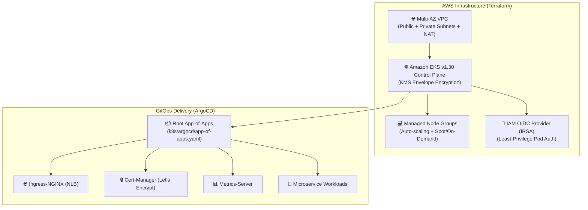

# AWS EKS GitOps Platform ☸️🚀

> **Production-Ready AWS EKS Infrastructure & GitOps Engine** — Built with Terraform modules, IAM Roles for Service Accounts (IRSA), KMS Envelope Encryption, and ArgoCD App-of-Apps continuous deployment.

[](https://github.com/TarunKumarPardeshi/aws-eks-gitops-platform/actions/workflows/terraform.yml)
[](https://www.terraform.io/)
[](https://kubernetes.io/)
[](https://argo-cd.readthedocs.io/)
[](https://aws.amazon.com/eks/)

---

## 📖 Architecture Overview

This platform provisions an enterprise-grade Kubernetes foundation on AWS following the Well-Architected Framework:



---

## ✨ Features

- **Networking**: Multi-AZ VPC across 2+ Availability Zones with dedicated public (ELB-facing) and private (Worker node) subnets, NAT Gateways, and route table associations.
- **Security & Hardening**:
  - AWS KMS Customer Managed Key (CMK) envelope encryption for Kubernetes Secrets.
  - IAM OIDC provider enabling **IRSA (IAM Roles for Service Accounts)** so pods assume fine-grained IAM roles without static AWS credentials.
  - Private endpoint access for EKS API server with configurable public CIDR whitelisting.
- **EKS Managed Node Groups**: Launch templates supporting Spot/On-Demand instances, Cluster Autoscaler tags, and rolling zero-downtime upgrades.
- **GitOps Continuous Delivery**: ArgoCD App-of-Apps pattern managing platform add-ons (`ingress-nginx`, `cert-manager`, `metrics-server`) and sample microservices with auto-sync and self-healing.

---

## 🚀 Quick Start Deployment

### 1. Prerequisites

- AWS CLI v2 (`aws configure`)
- Terraform $\ge 1.5.0$
- `kubectl` $\ge 1.28$

### 2. Provision Infrastructure via Terraform

```bash
cd terraform/envs/dev

# 1. Initialize modules and providers
terraform init

# 2. Review execution plan
terraform plan

# 3. Apply infrastructure
terraform apply -auto-approve
```

### 3. Connect to EKS Cluster

```bash
# Update local kubeconfig
aws eks update-kubeconfig --name eks-gitops-dev --region us-east-1

# Verify nodes are Ready
kubectl get nodes -o wide
```

### 4. Bootstrap ArgoCD & GitOps Pipeline

```bash
# Install ArgoCD in the cluster
kubectl create namespace argocd
kubectl apply -n argocd -f https://raw.githubusercontent.com/argoproj/argo-cd/stable/manifests/install.yaml

# Apply the Root App-of-Apps
kubectl apply -f k8s/argocd/app-of-apps.yaml

# Watch ArgoCD synchronize infrastructure and applications
kubectl get applications -n argocd
```

---

## 📂 Repository Layout

```
├── .github/workflows/
│   └── terraform.yml               # CI formatting, linting & validation
├── terraform/
│   ├── modules/
│   │   ├── vpc/                    # Multi-AZ VPC module
│   │   └── eks/                    # EKS, IRSA, KMS, and Node Group module
│   └── envs/
│       └── dev/                    # Environment-specific root module
├── k8s/
│   ├── argocd/
│   │   ├── app-of-apps.yaml        # Root GitOps Application
│   │   └── applications/           # Child ArgoCD applications
│   └── workloads/
│       └── sample-app/             # Sample deployment & service manifests
└── README.md
```

---

## 👨‍💻 Author

**Tarun Kumar Pardeshi** — Cloud & DevOps Engineer
- GitHub: [@TarunKumarPardeshi](https://github.com/TarunKumarPardeshi)
